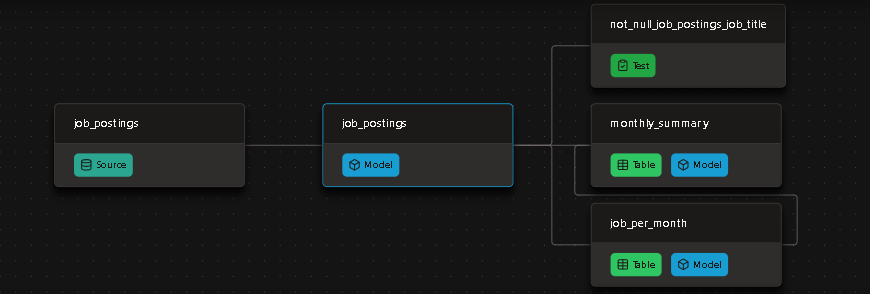

# Job Postings Pipeline — dbt + DuckDB


A tested, documented and automated analytics pipeline built with **dbt** on **DuckDB**. It turns a year of raw, messy job-posting data (about 843,000 scraped rows stored as monthly Parquet files) into clean, query-ready tables that answer questions about the data-jobs market.

> Built while following Luke Barousse's free course *dbt for Data Analytics & Engineering* ([course repo](https://github.com/lukebarousse/dbt_Analytics_Engineering_Course)). Dataset © the course author.

---

## What I built

| What | How | Where to look |
| --- | --- | --- |
| **dbt pipeline** | Raw Parquet declared as a source → cleaned model → summary marts | [`analytics/models/`](analytics/models/) |
| **No hard-coded paths** | File location lives in `sources.yml`; models use `source()` and `ref()` | [`sources.yml`](analytics/models/sources.yml) |
| **Data tests** | `not_null` / `unique` checks that run on every build | [`schema.yml`](analytics/models/schema.yml) |
| **Documentation** | Model and column descriptions, pushed into the warehouse with `persist_docs` | [`schema.yml`](analytics/models/schema.yml) |
| **Materializations** | Project default `table`; the cleaning model overridden to `view` | [`dbt_project.yml`](analytics/dbt_project.yml) |
| **Environments** | `dev` (local) and `prod` targets, separate DuckDB files | [`ci/profiles.yml`](ci/profiles.yml) |
| **Automation** | GitHub Actions rebuilds and tests everything on every push and every Monday | [`.github/workflows/dbt_build.yml`](.github/workflows/dbt_build.yml) |

---

## The dbt pipeline works

Raw postings flow through three dbt layers — declared sources → cleaned staging views → insight marts — with tests gating every build. The DAG below is the whole flow:



| Model | Materialization | Grain (one row per…) | Answers |
| --- | --- | --- | --- |
| `job_postings` | view | posting scrape | The cleaned base all other models read from |
| `job_per_month` | table | month × role | How many postings each role had each month |
| `monthly_summary` | table | month | Total postings, remote postings and remote share |

**Why view vs table:** `job_postings` is only read by other models, so it stays a view (no extra storage, always current). The marts are what people query, so they are stored as tables for fast reads.

`dbt build` runs each model and then its tests in dependency order. If a test fails, every model downstream of it is skipped, so bad data never reaches the summary tables.

---

## Tech stack

- **dbt v2**: transformations, tests, docs (DuckDB adapter built in)
- **DuckDB**: local analytical warehouse (one file)
- **uv**: Python and package management (`pyproject.toml` + `uv.lock`)
- **GitHub Actions**: scheduled build and test in the cloud

---

## Automation

[`.github/workflows/dbt_build.yml`](.github/workflows/dbt_build.yml) runs on:

| Trigger | When |
| --- | --- |
| Push to `main` | Every code change |
| Schedule | Mondays 06:17 UTC (`cron: '17 6 * * 1'`) |
| Manual | "Run workflow" button in the Actions tab |

Each run starts on a fresh machine: installs with `uv sync`, downloads the raw data, runs `dbt build` against the `prod` target using the committed [`ci/profiles.yml`](ci/profiles.yml), and publishes the finished `prod.duckdb`.

---
## Query the published warehouse

No clone required [Install DuckDB](https://duckdb.org/docs/installation/) then from a `duckdb` session.

```sql
INSTALL httpfs;
LOAD httpfs;

ATTACH 'https://github.com/devayani24/dbt-duckdb-pipeline/releases/download/warehouse/prod.duckdb' AS jobs;

USE jobs;
SHOW TABLES;

SELECT * FROM job_per_month
SELECT * FROM monthly_summary
```


---
## 📖 Docs
Docs are generated with dbt docs generate and published to GitHub Pages:


The site shows:

The full lineage graph (sources → models → marts)
Model and column descriptions from the YAML
Which columns carry tests

## 💻 Run it yourself

``` bash
uv sync
uv run python scripts/download_data.py
cd analytics && uv run dbt build
```
Optional docs locally:
``` bash
uv run dbt docs generate
uv run dbt docs serve
```
---

## 📁 Project layout

```text
.
├── .github/workflows/
│   └── dbt_build.yml     # CI: build + test
├── ci/profiles.yml       # prod target for CI
├── data/                 # raw + DuckDB (gitignored)
├── docs/                 # dbt docs (GitHub Pages)
├── scripts/
│   └── download_data.py  # fetches raw parquet
└── analytics/            # the dbt project
    ├── dbt_project.yml   # project settings
    └── models/           # SQL models + YAML
```
---

## What I learned

- Structuring SQL as small dbt models linked with `ref()`, so dbt works out build order and lineage
- Declaring raw files once as a `source` instead of hard-coding paths
- Choosing view vs table by who reads a model and how often
- Writing data tests and using `dbt build` to stop bad data spreading downstream
- Keeping connection details in `profiles.yml`, outside the repo, with separate dev and prod targets
- Automating a build-and-test run with GitHub Actions

## Next

Rebuilding this pipeline on **Databricks** (Unity Catalog, incremental models, SCD2 snapshots, a scheduled Databricks Job).